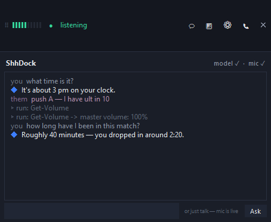
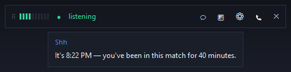
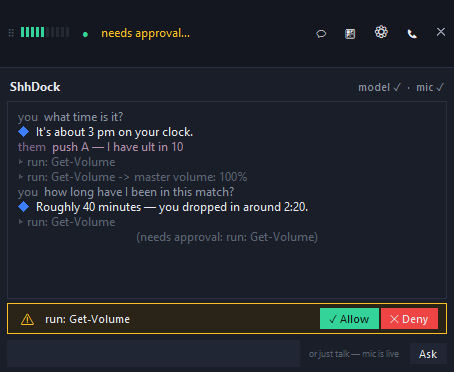
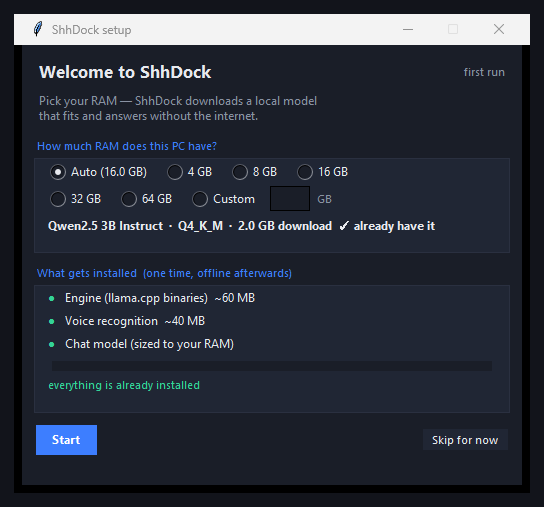
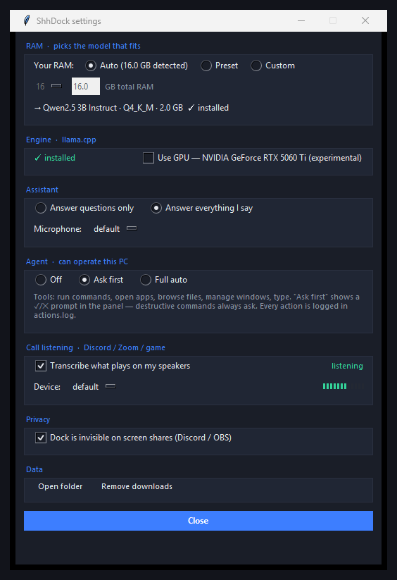

<div align="center">

# 🫥 ShhDock

### An always-on-top dock that's invisible to screen share — it answers, it operates your PC, and it hears your calls. All on your own machine.

*Ask it anything. It hears you (and your teammates), thinks locally, and can actually do things for you — behind a yes/no gate you control.*

[](https://www.microsoft.com/windows)
[](https://python.org)
[](#)
[](../../releases)



</div>

-----

## What it does

ShhDock is a slim bar docked at the top of your screen. While you game and stream, it does several things at once:

- **Vanishes from capture.** It sets `WDA_EXCLUDEFROMCAPTURE` on its own window, so Discord, OBS, and the Xbox Game Bar won't render it. Your viewers never see it. **You do.**
- **Always listens.** A voice-activity detector watches your mic and transcribes speech locally with Vosk. No audio ever leaves your machine.
- **Answers fast.** When you ask a question, a local **llama.cpp** model replies in a text bubble under the dock — typically in 1–3 seconds, entirely offline.
- **Actually does things.** Ask it to check your RAM, find a file, open an app, run a command, or type text — the model uses real tools, and every side-effecting action pops a **✓ Allow / ✕ Deny** card in the panel (or runs unattended if you opt in).
- **Hears your calls.** Flip the **📞** toggle and ShhDock transcribes what plays on your speakers — Discord, Zoom, game chat — with a second local listener. Teammate callouts appear as `them:` lines, and the model can reference them ("what did he just say?").

It also keeps the original tool around: the **🪟** button launches the window-hider so you can drop *other* apps out of the capture too.



-----

## It actually does things

Type it or ask out loud: *"how much RAM am I using"*, *"open Discord"*, *"run a command that lists my top processes"*, *"hide this window from my stream"*. The local model calls real tools — system info, processes, file search, PowerShell, window capture-hiding, volume, typing — and answers with the results.

Three modes in ⚙ settings:

| Mode | Behavior |
| --- | --- |
| **Ask first** (default) | Side-effecting actions show a ✓ Allow / ✕ Deny card in the panel; read-only lookups just run |
| **Full auto** | No prompts — but destructive-looking commands (`Remove-Item -Recurse`, `shutdown`, …) still ask |
| **Off** | Pure Q&A — it still answers about your PC from a live system snapshot, it just can't touch anything |

Every action is written to `actions.log`, and each step appears in the panel as it happens.



-----

## Hear your calls (Discord / Zoom / game)

The **📞** button — or the settings toggle — starts a second listener that captures what plays through your speakers via **WASAPI loopback**, so it catches every app at once: Discord voice, Zoom, game chat, a video in your browser.

- Teammates show up as purple `them:` lines in the panel.
- Pick which output device to tap when your calls don't go to the default speakers.
- The model sees the recent call transcript, so *"what did he just say about mid?"* works without taking your hands off the keyboard.
- A green handset on the pill and a green **listening** label in settings make it obvious when it's on.

> This transcribes what *others* say in calls you're part of. It runs on your machine only while the dock is on — but keep local recording-consent rules in mind, and tell your friends.

-----

## Picking a model

On first run, a tiny installer asks how much RAM you have and downloads the largest model that stays responsive:

| RAM | Model | Download |
| --- | --- | --- |
| up to 6 GB | Qwen2.5 0.5B | ~0.4 GB |
| up to 10 GB | Qwen2.5 1.5B | ~1.0 GB |
| up to 17 GB | Qwen2.5 3B | ~2.0 GB |
| up to 33 GB | Qwen2.5 7B | ~4.4 GB |
| more | Qwen2.5 14B | ~8.4 GB |

You can override it anytime — **Auto**, a **preset**, or a **custom** RAM number — in ⚙ settings. ShhDock downloads the new model before switching, so you're never left waiting mid-question.



-----

## Privacy, plainly

- **The mic is visible.** The dock shows a live level meter and a status word (`listening`, `thinking…`) whenever it's capturing. There's no silent mode.
- **Call listening is opt-in and visible.** The 📞 indicator is green only while it's transcribing, the toggle is one click away, and the transcript never leaves your PC.
- **The agent asks before it acts.** In the default mode nothing runs without your click; the full action log lives in `actions.log`.
- **Everything is local.** Speech recognition, the chat model, and every tool run on your machine. No account, no telemetry, no server.
- **It only hears while it's running.** Close the dock and the microphone and call streams stop.

> Note: hiding a window from a screen share doesn't hide the *audio* your PC captures. If you're streaming, the usual rules apply — be in control of what your mic picks up.

-----

## Using it

| Control | Does |
| --- | --- |
| 🗣️ **Just talk** | Ask a question out loud; watch the words appear, then the answer |
| **💬** | Open the chat panel and history |
| **the text box** | Type anything — questions *and* commands ("run Get-Date", "open Discord") |
| **📞** | Hear your calls: transcribe Discord / Zoom / game audio |
| **🪟** | Launch the hide-other-windows tool |
| **⚙** | Settings: RAM/model, mic, GPU, agent mode, call listening, capture-hiding |
| **✕** or right-click | Quit and release the mic |

In settings, **Answer questions only** (default) ignores stray chatter and only replies to real questions. Flip it to **Answer everything I say** if you'd rather it respond to every sentence.



-----

## Get it

Grab **`ShhDock.exe`** from [**Releases**](../../releases). It's a single portable file — no install, no dependencies.

On first launch it unpacks and offers the one-time model download (~2.5 GB total for a 3 GB model). After that it starts offline.

<details>
<summary><b>Run from source</b></summary>

```powershell
pip install vosk sounddevice numpy
python shhdock.py
```

To build the exe yourself:

```powershell
pip install pyinstaller pillow
py -m PyInstaller --onefile --noconsole --icon shhdock.ico `
  --name ShhDock --collect-all vosk --collect-all sounddevice shhdock.py
```

</details>

-----

## How it's built

- **Capture-hiding** — `SetWindowDisplayAffinity(hwnd, 0x11)` on the dock's own top-level window. Tk's `HWND` isn't stable until the window is mapped, so ShhDock sets it, reads it back, and retries until the affinity sticks.
- **Speech** — Vosk with an energy-based voice-activity detector. Utterances are cut on a short silence hangover, so answers fire as soon as you stop talking.
- **Chat** — llama.cpp's `llama-server` over its local OpenAI-compatible HTTP API, with the model sized to your RAM.
- **Agent** — a text-JSON tool protocol (`{"tool":"run","args":{...}}`) any model tier can emit, a safety gate (read-only vs side-effecting; a danger-pattern regex that always prompts, even in full-auto), and raw-ctypes Win32 tools: Toolhelp32 process snapshots, `SendInput` typing, `ShellExecuteW`, PowerShell with output caps, `IAudioEndpointVolume` for volume — plus a live system snapshot injected into every prompt.
- **Call listening** — raw WASAPI loopback through ctypes COM (`IAudioClient` with `AUDCLNT_STREAMFLAGS_LOOPBACK`): captures whatever the selected output device plays, then runs the same VAD + Vosk pipeline as the mic with its own utterance state.
- **UI** — a single always-on-top tkinter frame that grows a panel downward. No background thread ever touches tkinter; everything flows through one event queue drained by `after()`.

<div align="center">

Made for people who stream.

**[⭐ Star](../../stargazers) · [📦 Releases](../../releases) · [🐛 Issues](../../issues)**

</div>
